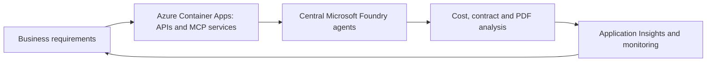

# Hemanth Kumar Dannaboyina

Senior SRE, cloud and AI platform engineer with 8+ years of experience across Azure, AWS and GCP. I connect business requirements, application engineering and production operations.

[Explore my portfolio](https://hemanth-kumar-engineering.hkaiverse.chatgpt.site) · [LinkedIn](https://www.linkedin.com/in/hemanth-kumar-yadav-79078b1b2/) · [Contact](mailto:hemanthkyadav07@gmail.com)

## Selected engineering work

| Project | My contribution | Context |
| --- | --- | --- |
| Agent Hub | Built centralized AI-agent tracking and business-management dashboards on Azure App Service from stakeholder requirements. | AT&T |
| Kubernetes and Launchpad | Enterprise Kubernetes operations, public-to-private AKS migration, GitOps and self-service infrastructure for engineering teams. | Procter & Gamble via LTIMindtree |
| Enterprise GenAI | Python, RAG, MCP and multi-agent application delivery with evaluation, human approval, observability and cost controls. | AT&T |
| HKAIVERSE PVT LTD | Azure Container Apps application APIs and MCP services connected to central Microsoft Foundry agents for cost, contract and PDF analysis, with end-to-end FDE delivery and Application Insights. | Independent startup engagement |
| Leanova OPEX Solutions | Website delivery and GenAI architecture for operational-improvement and document-analysis POC use cases. | Independent startup engagement |
| Adaptive Systems Framework | Created the ASF proof of concept, connecting evidence and context to governed advisory actions and feedback. | Independent R&D / POC |

[Read the case studies](docs/case-studies.md) or explore the interactive architecture and Hemanth AI Voice Assistant on my portfolio.

## Resumes

Updated November 26, 2026. Each PDF and Word version includes the readable personal portfolio URL and its matching QR code. All versions retain the same career history.

- [Complete resume](resumes/Hemanth_Kumar_Dannaboyina_Resume.pdf)
- [Senior SRE / Cloud Platform](resumes/Hemanth_Kumar_Dannaboyina_Senior_SRE_Cloud.pdf)
- [GenAI Platform Engineering](resumes/Hemanth_Kumar_Dannaboyina_GenAI_Platform.pdf)
- [Forward-Deployed Engineering](resumes/Hemanth_Kumar_Dannaboyina_Forward_Deployed.pdf)

- [Azure / Customer Solutions](resumes/Hemanth_Kumar_Dannaboyina_Azure_Customer_Solutions.pdf)
- [Word resume](resumes/Hemanth_Kumar_Dannaboyina_Resume.docx)

## Architecture overview

This is a public professional portfolio. It contains approved career descriptions and resume PDFs, not private employer or client source code, internal screenshots, credentials or customer data. Diagrams are explanatory recreations. ASF remains a POC; architecture, implementation and production acceptance are distinct.
